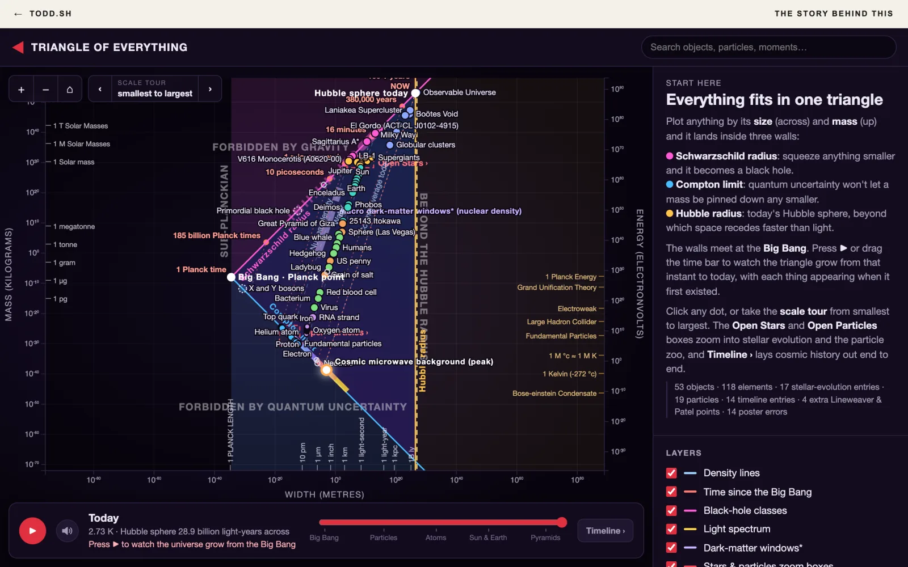

# The Triangle of Everything

Plot anything in the universe by its size and its mass, and it lands inside one triangle: black holes on one wall, fundamental particles on another, and the Hubble radius closing it off. This repository rebuilds that chart from data, checked against physics, so the universe can be played back from the instant the three walls meet to today.

**Play it:** [todd.sh/triangle/app](https://www.todd.sh/triangle/app) · **The story behind it:** [todd.sh/triangle](https://www.todd.sh/triangle)



## What's here

| Folder | Contents |
| --- | --- |
| [`data/`](data/) | The datasets, as JSON and CSV: 53 objects, the stellar-evolution and particle insets, the cosmic timeline with 701 moments of expansion history, Lineweaver & Patel's points, all 118 elements, and 14 errors found in the poster. See [`data/README.md`](data/README.md). |
| [`scripts/`](scripts/) | `build_data.py` writes everything in `data/` (standard library only). `check_physics.py` confirms the data is physically consistent. `render_overlay.py` draws the data back onto the source images. `build-web.mjs` assembles the site for deployment. |
| [`site/`](site/) | The interactive chart: plain HTML, CSS and ES modules with D3, no build step. See [`site/README.md`](site/README.md). |
| [`story/`](story/) | The write-up page served at todd.sh/triangle. |

## Run it locally

Serve the repository root, because the chart loads `../data/*.json`:

```bash
python3 -m http.server 8642
```

Then open <http://localhost:8642/site/> for the chart and <http://localhost:8642/story/> for the story.

## Rebuild and check the data

```bash
python3 scripts/build_data.py
python3 scripts/check_physics.py
```

## Deployment

Vercel runs `node scripts/build-web.mjs` (see [`vercel.json`](vercel.json)), which puts the story at `/`, the chart at `/app` and the datasets at `/data`, with `<base>` tags for the `/triangle` prefix that [todd.sh](https://www.todd.sh) serves them under.

## Source images

The two charts this started from aren't included, because they're other people's work:

- **All objects**, from Charles H. Lineweaver and Vihan M. Patel, [All objects and some questions](https://pubs.aip.org/aapt/ajp/article/91/10/819/2911822/All-objects-and-some-questions), American Journal of Physics 91, 819 (2023).
- **The Triangle of Everything**, an illustrated poster version of the same chart.

`render_overlay.py` expects them in the repository root as `b6y2fthj95ie1.png` and `Triangle_of_Everything.png`.

## Sources

- Lineweaver & Patel (2023), above: the chart and its points.
- Planck Collaboration, [Planck 2018 results. VI. Cosmological parameters](https://arxiv.org/abs/1807.06209), A&A 641, A6 (2020): the expansion history.
- [PubChem periodic table](https://pubchem.ncbi.nlm.nih.gov/periodic-table/): element masses and van der Waals radii.
- Jennifer A. Johnson, [Populating the periodic table: Nucleosynthesis of the elements](https://www.science.org/doi/10.1126/science.aau9540), Science 363, 474 (2019): where each element is made.
- [Particle Data Group](https://pdg.lbl.gov/): particle masses.
- Jacobs, Starkman & Lynn, [Macro dark matter](https://arxiv.org/abs/1410.2236), MNRAS 450, 3418 (2015): the dark-matter windows.
